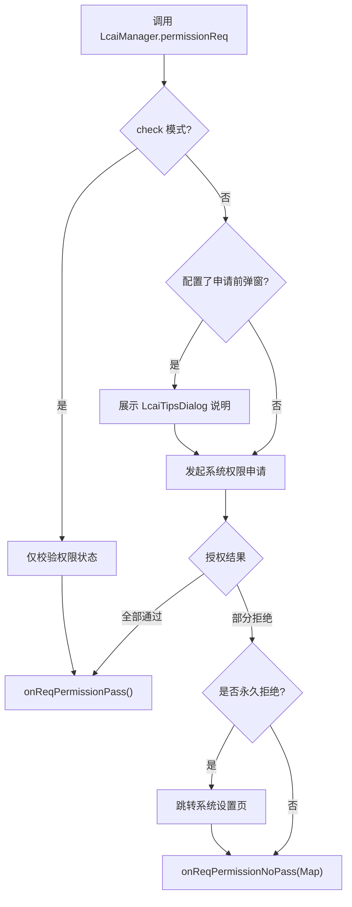
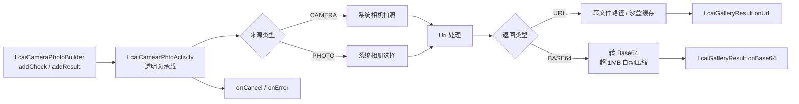

---
# Lcai 项目架构概览与模块索引

  本项目采用高度模块化设计。各模块间高度解耦，通过底层的 `core` 模块提供基础支撑，并由核心门面 `LcaiManager` 统一调度需要异步和生命周期的跨模块交互（如权限、拍照）。


    > **摘要**：本文系统梳理了 Lcai 项目的整体架构与模块索引。项目采用高度模块化设计，以 `core` 模块作为底层基石，提供全局 Context、Activity 生命周期、文件沙盒与线程池等通用能力；由核心门面 `LcaiManager` 统一收口权限申请、拍照选图等需要异步与生命周期的跨模块交互。在此之上，`http`、`lcaidb`、`preference`、`json` 构成基础底座层，`eventBus`、`jsbridge` 承担通信与混合开发职责，`permission`、`camera_photo`、`image` 提供核心业务能力，`component`、`tipsdialog` 则封装开箱即用的 UI 与弹窗组件。全文按「基础底座 → 通信混合 → 核心业务 → UI 交互」四层展开，并逐模块给出关键类与方法速查表，便于快速定位与二次开发。


  ## 📑 目录

  - [🧭 模块依赖关系](#-模块依赖关系)
      - [🗂️ 四层架构总览](#️-四层架构总览)
  - [📦 一、基础底座层 (Infrastructure)](#-一基础底座层-infrastructure)
  - [📡 二、通信与混合开发层 (Communication)](#-二通信与混合开发层-communication)
  - [🛠️ 三、核心业务功能层 (Core Features)](#️-三核心业务功能层-core-features)
  - [🎨 四、UI 与交互组件层 (UI Components)](#-四ui-与交互组件层-ui-components)
  - [1. core 模块 (核心基础库)](#1-core-模块-核心基础库)
      - [1.1 `LcaiManager`](#11-lcaimanager)
      - [1.2 `GlobalAppUtil`](#12-globalapputil)
      - [1.3 `LcaiActivityManager`](#13-lcaiactivitymanager)
      - [1.4 `LcaiFileUtils`](#14-lcaifileutils)
  - [2. permission 模块 (动态权限)](#2-permission-模块-动态权限)
      - [2.1 `LcaiPermissionRequestBulider`](#21-lcaipermissionrequestbulider)
      - [2.2 `LcaiPermissionUtils`](#22-lcaipermissionutils)
      - [2.3 `LcaiReqPermissionResult` (接口)](#23-lcaireqpermissionresult-接口)
  - [3. camera_photo 模块 (相机与相册)](#3-camera_photo-模块-相机与相册)
      - [3.1 `LcaiCameraPhotoBuilder`](#31-lcaicameraphotobuilder)
      - [3.2 `LcaiGalleryResult` (接口)](#32-lcaigalleryresult-接口)
      - [3.3 `LcaiCamearPhtoActivity` (内部透明页)](#33-lcaicamearphtoactivity-内部透明页)
  - [4. http 模块 (网络请求)](#4-http-模块-网络请求)
      - [4.1 `LcaiHttpRequestBulider`](#41-lcaihttprequestbulider)
      - [4.2 `LcaiBaseResponseResult` (接口)](#42-lcaibaseresponseresult-接口)
      - [4.3 `GlobalThreadPool`](#43-globalthreadpool)
  - [5. eventBus 模块 (事件总线)](#5-eventbus-模块-事件总线)
      - [5.1 `LcaiEventBus`](#51-lcaieventbus)
      - [5.2 `MessageEvent` / `Subscribe` / `ThreadMode`](#52-messageevent--subscribe--threadmode)
  - [6. image 模块 (图片处理)](#6-image-模块-图片处理)
      - [6.1 `ImageUtils` (Glide 封装)](#61-imageutils-glide-封装)
      - [6.2 `LcaiImageCore` (纯算法)](#62-lcaiimagecore-纯算法)
      - [6.3 `LcaiShapePathFactory`](#63-lcaishapepathfactory)
  - [7. jsbridge 模块 (Hybrid 通信与 WebView 容器)](#7-jsbridge-模块-hybrid-通信与-webview-容器)
      - [7.1 `WebActivity` (WebView 容器页)](#71-webactivity-webview-容器页)
      - [7.2 `WebActivityConfig` (页面配置类)](#72-webactivityconfig-页面配置类)
      - [7.3 `LcaiWebActivityRouter`](#73-lcaiwebactivityrouter)
      - [7.4 `LcaiBridgeWebview` (核心 WebView)](#74-lcaibridgewebview-核心-webview)
      - [7.5 `LcaiBridgeUtil` (工具类)](#75-lcaibridgeutil-工具类)
      - [7.6 其他核心类](#76-其他核心类)
  - [8. lcaidb 模块 (仿 MyBatis-Plus 的 SQLite 数据库)](#8-lcaidb-模块-仿-mybatis-plus-的-sqlite-数据库)
      - [8.1 `LcaidbCore<T>` (业务操作门面)](#81-lcaidbcoret-业务操作门面)
      - [8.2 `LcaidbHelper` (数据库初始化)](#82-lcaidbhelper-数据库初始化)
      - [8.3 核心 SQL 生成器](#83-核心-sql-生成器)
  - [9. tipsdialog 模块 (通用弹窗组件)](#9-tipsdialog-模块-通用弹窗组件)
      - [9.1 `LcaiTipsDialogBuilder` (构建器)](#91-lcaitipsdialogbuilder-构建器)
      - [9.2 `LcaiTipsDialog` (内部实现类)](#92-lcaitipsdialog-内部实现类)
      - [9.3 `OnTipsDialogInterface` (回调接口)](#93-ontipsdialoginterface-回调接口)
      - [9.4 `SegDisplayModule` (富文本片段实体)](#94-segdisplaymodule-富文本片段实体)
  - [10. component 模块 (通用 UI 组件库)](#10-component-模块-通用-ui-组件库)
      - [10.1 基础 View 体系](#101-基础-view-体系)
      - [10.2 列表体系](#102-列表体系)
      - [10.3 核心高级 UI 组件](#103-核心高级-ui-组件)
  - [11. preference 模块 (键值存储)](#11-preference-模块-键值存储)
      - [`LcaiPreferenceUtils`](#lcaipreferenceutils)
  - [12. json 模块 (安全 JSON 解析)](#12-json-模块-安全-json-解析)
      - [`JSONUtils`](#jsonutils)
  - [13. security 模块 (加解密与摘要)](#13-security-模块-加解密与摘要)
      - [13.1 `LcaiEncryptionCore` (统一加密门面)](#131-lcaiencryptioncore-统一加密门面)
      - [13.2 `LcaiAES256Util` (AES-256-GCM)](#132-lcaiaes256util-aes-256-gcm)
      - [13.3 `LcaiRSAUtil` (RSA-OAEP + 签名)](#133-lcairrsautil-rsa-oaep--签名)
      - [13.4 `LcaiBase64Util` (编码工具)](#134-lcaibase64util-编码工具)
      - [13.5 `LcaiMD5Util` (摘要)](#135-lcaimd5util-摘要)
      - [13.6 `LcaiEncryption` (枚举)](#136-lcaiencryption-枚举)
  - [📌 总结](#-总结)
      - [参考资料](#参考资料)
    添加依赖配置

    在项目的 `build.gradle`（Module级别）文件中，添加以下依赖项：

    ```groovy
    implementation 'com.github.liucai-bit:lcaipermission:2.0.45'
    ```

    确保已添加 JitPack 仓库地址，若未添加，请在项目根目录的 `build.gradle` 文件中加入：

    ```groovy
    allprojects {
    repositories {
    maven { url 'https://jitpack.io' }
    }
}
    ```

  ### 项目源码与文档地址

    该项目的官方 GitHub 仓库地址为：

  [https://github.com/liucai-bit/lcaipermission/tree/master](https://github.com/liucai-bit/lcaipermission/tree/master)

    该页面包含完整的项目结构、使用说明、示例代码及最新更新日志，建议查阅以获取详细集成与使用信息。


  ## 🧭 模块依赖关系

    下图展示了各模块之间的依赖方向：`core` 位于最底层，为所有模块提供 Context、Activity 生命周期、文件与线程等基础能力；`LcaiManager` 作为统一门面，负责调度 `permission` 与 `camera_photo` 这类需要异步与生命周期的跨模块交互；`http`、`lcaidb`、`preference`、`json`、`eventBus`、`jsbridge`、`image`、`component`、`tipsdialog` 则按各自职责向上层业务提供能力。

    ```mermaid
    flowchart TD
    CORE["core 基础底座<br/>GlobalAppUtil / LcaiActivityManager / LcaiFileUtils"]
    MGR["LcaiManager 核心门面"]
    PERM["permission 动态权限"]
    CAM["camera_photo 相机与相册"]
    HTTP["http 网络请求"]
    DB["lcaidb 本地数据库"]
    PREF["preference 键值存储"]
    JSON["json 安全解析"]
    BUS["eventBus 事件总线"]
    BRIDGE["jsbridge Hybrid 通信"]
    IMG["image 图片处理"]
    COMP["component UI 组件库"]
    DIALOG["tipsdialog 弹窗组件"]

    CORE --> MGR
    CORE --> HTTP
    CORE --> DB
    CORE --> PREF
    CORE --> JSON
    CORE --> BUS
    CORE --> BRIDGE
    CORE --> IMG
    CORE --> COMP
    CORE --> DIALOG

    MGR --> PERM
    MGR --> CAM

    PERM --> DIALOG
    CAM --> IMG
    CAM --> PREF
    BRIDGE --> PERM
    BRIDGE --> IMG
    BRIDGE --> COMP
    HTTP --> JSON
    DB --> JSON
    IMG --> COMP
    DIALOG --> COMP
    ```

    分层原则可以概括为「自下而上单向依赖、门面统一收口」：底层模块不感知上层业务，只暴露稳定的通用能力；上层模块可以依赖下层，但下层绝不反向引用上层，从而保证模块可独立替换与测试。凡是涉及异步回调、Activity 生命周期或跨模块协作的能力（如权限申请、拍照选图），统一由 `LcaiManager` 作为唯一入口对外暴露，避免调用方直接耦合具体实现，也让资源释放与引用清理集中在一处完成。

  ### 🗂️ 四层架构总览

    为便于从整体把握，下面用一张分层图概括「基础底座 → 通信混合 → 核心业务 → UI 交互」四层结构，以及各层包含的模块：

    ```mermaid
    flowchart BT
    subgraph L1["📦 基础底座层 Infrastructure"]
    CORE["core 核心基础库"]
    HTTP["http 网络请求"]
    DB["lcaidb 本地数据库"]
    PREF["preference 键值存储"]
    JSON["json 安全解析"]
    end

    subgraph L2["📡 通信与混合开发层 Communication"]
    BUS["eventBus 事件总线"]
    BRIDGE["jsbridge Hybrid 通信"]
    end

    subgraph L3["🛠️ 核心业务功能层 Core Features"]
    PERM["permission 动态权限"]
    CAM["camera_photo 相机与相册"]
    IMG["image 图片处理"]
    end

    subgraph L4["🎨 UI 与交互组件层 UI Components"]
    COMP["component UI 组件库"]
    DIALOG["tipsdialog 弹窗组件"]
    end

    L1 --> L2
    L2 --> L3
    L3 --> L4
    `## 📦 一、基础底座层 (Infrastructure)ucture)
    提供全局的通用能力、存储与网络基建，是上层业务运行的基石。

    *   **🔧 core (核心基础库)**
    *   **定位**：整个项目的基石。
    *   **简介**：提供全局 Context 管理 (`GlobalAppUtil`)、Activity 栈与生命周期管理 (`LcaiActivityManager`)、文件沙盒处理 (`LcaiFileUtils`)、日志系统以及核心调度门面 (`LcaiManager`)。
    *   **🌐 http (原生网络请求库)**
    *   **定位**：零第三方依赖的网络客户端。
    *   **简介**：基于 `HttpURLConnection` 和全局线程池手写封装。支持 GET/POST、文件上传下载、流式响应、进度回调及主动取消。
    *   **💾 lcaidb (本地数据库 ORM)**
    *   **定位**：仿 MyBatis-Plus 的 SQLite 框架。
    *通过注解 (`@TableName` 等) 和反射机制，自动完成建表与 CRUD 操作，内置防 SQL 注入机制，极大简化原生 SQLite 开发。SQLite 开发。
    *   **💽 preference (轻量键值存储)**
    *   **定位**：SharedPreferences 极简封装。
    *   **简介**：统一了各类数据的存取接口，默认异步提交防卡顿，底层特殊处理了 `Double` 类型的精度丢失问题。
    *   **📄 json (安全 JSON 解析)**
    *   **定位**：防御性 JSON 工具。
    *   **简介**：封装 Fastjson，所有解析和取值操作均包含 `try-catch` 兜底，绝不抛出异常## 📡 二、通信与混合开发层（Communication）ommunication)
    解决应用内部通信以及原生*   **📢 eventBus（轻量事件总线）**Bus (轻量事件总线)**
    *   **定位**：发布-订阅框架。
    *   **简介**：**最大亮点是使用弱引用（WeakReference）持有订阅者**rence) 持有订阅者**，彻底避免*   **🌉 jsbridge（Hybrid 通信与容器）**Hybrid 通信与容器)**
    *   **定位**：Native 与 H5 交互桥梁。
    *   **简介**：完整手写了双向通信协议，内置 `WebActivity` 容器、生命周期安全销毁、H5 请求原生权限的桥接，完美## 🛠️ 三、核心业务功能层（Core Features） (Core Features)
    涉及系统权限、硬*   **🔐 permission（高兼容性动态权限）**sion (高兼容性动态权限)**
    *   **定位**：全版本适配的权限申请框架。
    *   **简介**：统一了 Android 6~14 的碎片化权限（如存储抽象标识自动映射）。支持申请前自定义弹窗、永久拒绝跳转系统设置。**（注：必须通过 `Lc*   **📷 camera_photo（相机与相册）**ra_photo (相机与相册)**
    *   **定位**：媒体获取组件。
    *   **简介**：提供系统相机拍照与相册选择功能。自动处理 Uri 并支持返回文件路径或 Base64 编码（超 1MB 自动压缩）。**（注：必须通过 `L*   **🖼️ image（图片处理）***🖼️ image (图片处理)**
    *      *   **简介**：上层（`ImageUtils`）封装 Glide，自动处理上下文安全；下层（`LcaiImageCore`）提供纯 Bitmap 算法，支持九宫格切分、旋转翻转及基于 Path 的异形（心形/星形）裁剪。 P## 🎨 四、UI 与交互组件层（UI Components）互组件层 (UI Components)*   **🧱 component（通用 UI 组件库）**mponent (通用 UI 组件库)**
    *   **定位**：高度封装抽象了所有 View 的初始化基类。包含超级强大的多状态 RecyclerView（`LcaiRecyclerView`）、支持手势翻页的轮播图（`ViewFlipperCarousel`）以及各类业务组合组件。a*   **💬 tipsdialog（通用弹窗组件）** tipsdialog (通用弹窗组件)**
    *   **定位**：全场支持默认、图片、列表、富文本、Loading 等 7 种模式。内置 Activity 存活校验防崩溃，支持异步 Loading 任务（`buildAsync`）和分段富文本点击。bui# 1. Core 模块（核心基础库）

  # 1. core 模块 (核心基础库)

  ### 1.1 `LcaiManager`
    | 方法名 | 参数 | 返回值 | 功能说明 |
    | :--- | :--- | :--- | :--- |
    | `getInstance()` | 无 | `LcaiManager` | 获取单例。 |
    | `permissionReq` | `LcaiPermissionRequestBulider` | `void` | 发起权限申请，内部调用 `LcaiPermissionRequest`。 |
    | `openPhotoOrCamera` | `LcaiCameraPhotoBuilder` | `void` | 发起拍照/选图，内部调用 `LcaiCameraPhoto`。 |
    | `clearPermissionReferences()` | 无 | `void` | 清空当前权限申请的 builder 引用。 |
    | `clearPhotoReferences()` | 无 | `void` | 清空| `Internal.getPermissionResult()` | 无 | `LcaiPermissionActivityResult` | 获取权限申请回调。 |
    | `Internal.getPhotoCameraResult()` | 无 | `LcaiGalleryResult` | 获取拍照相册回调。 |

    `LcaiManager` 作为全局唯一门面，把权限申请与拍照选图两条异步链路统一收口，调用方只需面向它编程：两条异步链路统一收口，调用方只需面向它编程：

    ```mermaid
    sequenceDiagram
    participant Caller as "业务调用方"
    participant MGR as "LcaiManager"
    participant PERM as "permission 模块"
    participant CAM as "camera_photo 模块"
    participant CB as "回调接口"

  Caller->>MGR: "permissionReq(builder)"
  MGR->>PERM: "发起权限申请"
  PERM-->>MGR: "onReqPermissionPass / NoPass"
  MGR-->>CB: "分发权限结果"

  Caller->>MGR: "openPhotoOrCamera(builder)"
  MGR->>CAM: "启动拍照 / 选图"
  CAM-->>MGR: "onUrl / onBase64 / onCancel"
  MGR-->>CB: "分发媒体结果"


  #### 快速接入示例

    下面给出两段可直接复制运行的示例，分别演示通过 `LcaiManager` 发起权限申请与拍照选图。两段代码均以 `Activity` 为宿主，回调统一由 `LcaiManager` 分发。

  **示例一：发起动态权限申请**

    ```java
    // 在 Activity 中发起权限申请
    LcaiManager.getInstance().permissionReq(
    new LcaiPermissionRequestBulider()
    .with(this)                                   // 宿主 Activity，用于系统弹窗与生命周期
    .addPermission(LcaiPermissionString.CAMERA)   // 可多次调用，添加多个权限
    .addPermission(LcaiPermissionString.STORAGE)
    .showDialog()                                 // 可选：申请前先弹说明弹窗
    .toSystem()                                   // 可选：永久拒绝时引导跳转系统设置
    .addResult(new LcaiReqPermissionResult() {
    @Override
    public void onReqPermissionPass() {
    // 回调线程：主线程（由 LcaiManager 统一切回 UI 线程）
    // 此处可安全操作 UI，或继续发起拍照/选图
    runOnUiThread(() -> {
    // 权限已全部授予，执行后续业务
    });
    }

    @Override
    public void onReqPermissionNoPass(Map<String, Boolean> deniedMap) {
    // 回调线程：主线程
    // key = 权限名，value = 是否被永久拒绝（true 需引导去系统设置）
  for (Map.Entry<String, Boolean> entry : deniedMap.entrySet()) {
    if (Boolean.TRUE.equals(entry.getValue())) {
    // 永久拒绝，提示用户前往设置手动开启
    }
}
}
})
    );
    ```

    > **回调线程与资源清理说明**
    > - `onReqPermissionPass()` / `onReqPermissionNoPass()` 均在主线程回调，可直接更新 UI。
    > - 权限流程结束后，`LcaiManager` 内部会调用 `clearPermissionReferences()` 释放本次 `LcaiPermissionRequestBulider` 的引用，避免宿主 Activity 泄漏；若在回调中不再需要该 builder，无需手动清理。
    > - 若宿主 Activity 在申请过程中被销毁，回调将不再触发，框架已做存活校验，不会因空指针崩溃。

  **示例二：拍照 / 相册选图**

    ```java
    // 在 Activity 中发起拍照或选图
    LcaiManager.getInstance().openPhotoOrCamera(
    new LcaiCameraPhotoBuilder()
    .addCheck(LcaiGalleryCheckType.CAMERA)        // CAMERA 拍照；PHOTO 相册
    .addResult(LcaiGalleryResultType.URL)         // URL 返回路径；BASE64 返回编码
    .setSave(true)                                // 可选：结果是否存入相册
    .setResult(new LcaiGalleryResult() {
    @Override
    public void onUrl(String json) {
    // 回调线程：主线程
    // json 内含文件路径、大小等信息，可直接解析使用
    runOnUiThread(() -> {
    // 拿到图片路径，展示或上传
});
}

    @Override
    public void onBase64(String json) {
    // 回调线程：主线程
    // 当 addResult 为 BASE64 时回调，超 1MB 已自动压缩
}

    @Override
    public void onCancel() {
    // 回调线程：主线程，用户主动取消
}

    @Override
    public void onError(String msg) {
    // 回调线程：主线程，拍照/选图失败
}
})
    );
    ```

    > **回调线程与资源清理说明**
    > - 四个回调（`onUrl` / `onBase64` / `onCancel` / `onError`）均在主线程触发，可放心操作 UI。
    > - 流程结束后 `LcaiManager` 会调用 `clearPhotoReferences()` 清空本次 `LcaiCameraPhotoBuilder` 引用，释放对宿主 Activity 的持有，防止内存泄漏。
    > - 拍照产生的临时文件由 `LcaiFileUtils` 管理，若业务不需要保留，可在回调中调用 `LcaiFileUtils.clearFile(file)` 主动清理，避免缓存堆积。
    > - 建议先通过示例一申请相机/存储权限，再调用本示例，避免因权限缺失导致 `onError`。

  ### 1.2 `GlobalAppUtil`
    | 方法名 | 参数 | 返回值 | 功能说明 |
    | :--- | :--- | :--- | :--- |
    | `init` | `Application` | `void` | 初始化全局 Application。 |
    | `getApplication()` | 无 | `Application` | 获取 Application。 |
    | `getApplicationContext()` | 无 | `Context` | 获取 Application Context。 |
    | `getActivity()` | 无 | `Activity` | 获取当前栈顶 Activity。 |
    | `isRunning` | `Activity` | `boolean` | Activity 是否存活。 |
    | `isForeground()` / `isBackground()` | 无 | `boolean` | 应用是否在前台/后台。 |
    | `isMainThread()` | 无 | `boolean` | 是否在主线程。 |
    | `runOnUiThread` / `runOnUiThreadDelayed` | `Runnable`, `long` | `void` | 切换到主线程执行。 |
    | `removeUiRunnable` | `Runnable` | `void` | 移除主线程任务。 |
    | `getCacheFile()` / `getCacheFile2()` | 无 | `File` | 获取缓存目录。 |
    | `getInternalCacheDir()` / `getFilesDir()` | 无 | `File` | 获取内部缓存/文件目录。 |
    | `setSaveLog` / `isSaveLog` | `boolean` | `void`/`boolean` | 设置/获取日志保存开关。 |
    | `setIsDebug` / `isDebug` | `boolean` | `void`/`boolean` | 设置/获取调试模式。 |
    | `globalSetObject` / `globalGetObject` | `String`, `Object` | `void`/`T` | 全局运行时 Map 存取。 |
    | `globalContainsKey` / `globalRemoveObject` / `globalClearObject` | `String` | `boolean`/`void` | 全局 Map 查/删/清空。 |
    | `getDensity()` / `dp2px()` / `px2dp()` / `sp2px()` | `float` | `float`/`int` | 屏幕密度与单位换算。 |
    | `getScreenWidth()` / `getScreenHeight()` | 无 | `int` | 屏幕宽高。 |
    | `isLandscape()` / `isTablet()` / `isNightMode()` | 无 | `boolean` | 横屏/平板/夜间模式判断。 |
    | `getStatusBarHeight` / `getNavigationBarHeight` | 无 / `Activity`, `ComponentInterface` | `int`/`void` | 获取状态栏/导航栏高度。 |
    | `getSystemFontScale` / `setSystemFontScale` | 无 / `float` | `float`/`void` | 获取/设置字体缩放。 |
    | `toast` | `CharSequence` | `void` | 主线程弹 Toast。 |
    | `copyText` | `CharSequence` | `void` | 复制文本。 |
    | `hideKeyboard` / `showKeyboard` | `Activity` / `View` | `void` | 隐藏/显示软键盘。 |
    | `resolveString` / `resolveColor` / `resolveDrawable` | `Context`, `int` | `String`/`int`/`Drawable` | 安全获取资源。 |
    | `keepScreenOn` / `setSecure` | `Activity`, `boolean` | `void` | 屏幕常亮 / 防截屏。 |
    | `getPackageName` / `getAppName` / `getDataDir` | 无 | `String` | 获取应用信息。 |
    | `getAppVersionName` / `getAppVersionCode` | 无 | `String`/`int`/`long` | 获取版本号。 |
    | `isAppInstalled` | `String` | `boolean` | 是否安装指定应用。 |
    | `isFirstLaunch()` | 无 | `boolean` | 是否首次启动。 |
    | `getProcessName()` / `isMainProcess()` | 无 | `String`/`boolean` | 进程名 / 是否主进程。 |
    | `getSystemModel` / `getDeviceBrand` 等 | 无 | `String` | 获取各种设备信息（Model, Brand, Manufacturer, Product...）。 |
    | `getDeviceSDK` / `getDeviceAndroidVersion` / `getDeviceDefaultLanguage` | 无 | `int`/`String` | SDK版本 / 系统版本 / 默认语言。 |
    | `isNetworkConnected` / `isWifiConnected` / `isMobileConnected` | 无 | `boolean` | 网络状态判断。 |
    | `registerNetworkCallback` / `unregisterNetworkCallback` | `NetworkCallback` | `void` | 注册/注销网络监听。 |
    | `isEmulator()` | 无 | `boolean` | 是否模拟器。 |
    | `openAppSettings` / `openNetworkSettings` / `openNotificationSettings` | `Activity` | `void` | 跳转各种系统设置页。 |
    | `getAvailableMemory()` | 无 | `long` | 获取可用内存。 |
    | `exitApp()` / `restartApp()` | 无 | `void` | 退出 / 重启应用。 |

  ### 1.3 `LcaiActivityManager`
    | 方法名 | 参数 | 返回值 | 功能说明 |
    | :--- | :--- | :--- | :--- |
    | `init` | `Application` | `void` | 注册生命周期监听。 |
    | `currentActivity()` | 无 | `Activity` | 获取栈顶 Activity（哪怕是 Paused）。 |
    | `getAllActivities()` | 无 | `List<Activity>` | 获取所有 Activity。 |
    | `hasActivity()` | 无 | `boolean` | 栈是否为空。 |
    | `getResumedActivity()` | 无 | `Activity` | 获取可见 Activity。 |
    | `isResumed` | `Activity` | `boolean` | 传入的 Activity 是否 Resumed。 |
    | `isAppForeground()` | 无 | `boolean` | 应用是否在前台。 |
    | `showLoading` / `dismissLoading` | `LoadingAction` | `void` | 安全的 Loading 控制。 |
    | `isLoadingShowing()` | 无 | `boolean` | Loading 是否展示中。 |
    | `finishFirstActivity` | `Activity` | `void` | 安全结束 Activity。 |
    | `finishAllActivities` / `finishAllOtherActivities` | `Class<?>` | `void` | 结束所有/其他 Activity。 |
    | `exitApp()` | 无 | `void` | 结束所有 Activity 并杀进程。 |
    | `startActivity` | `Context`, `Class<?>`, `Bundle` | `void` | 安全的 Activity 跳转。 |

  ### 1.4 `LcaiFileUtils`
    | 方法名 | 参数 | 返回值 | 功能说明 |
    | :--- | :--- | :--- | :--- |
    | `createImageFile` / `createCameraImageFile` | `Activity` | `File` | 创建临时图片文件。 |
    | `clearFile` | `File` | `void` | 删除文件。 |
    | `converImagePathToBase64` / `convertImageToBase64` / `cameraImageToBase64` | `String`/`Context, Uri, boolean`/`Intent, boolean` | `JSONObject` | 图片转 Base64（带压缩）。 |
    | `bitmapToBase64` | `Bitmap`, `boolean` | `String` | Bitmap 转 Base64。 |
    | `getPath` / `uriToCacheFile` | `Context`, `Uri` | `String`/`File` | Uri 转路径/沙盒文件。 |
    | `saveImageToGallery` | `Context`, `File`, `LcaiFileInterface` | `void` | 保存至相册。 |
    | `isExternalStorageDocument` 等 | `Uri` | `boolean` | 判断 Uri 类型。 |

  *(注：`LcaiLogUtils`、`TextUtils`、`CommonUtils` 等极简工具类方法在此略过，因功能一目了然)*

---

# 2. permission 模块 (动态权限)

### 2.1 `LcaiPermissionRequestBulider`
| 方法名 | 参数 | 返回值 | 功能说明 |
| :--- | :--- | :--- | :--- |
| `with` | `Activity` | `Builder` | 设置上下文。 |
| `check` | `boolean` | `Builder` | 仅检查不申请。 |
| `addNotification` | 无 | `Builder` | 添加通知权限（13+适配）。 |
| `showDialog` / `addDialogBulider` | 无 / `LcaiTipsDialogBuilder` | `Builder` | 配置申请前弹窗。 |
| `addPermission` | `String` / `String...` | `Builder` | 添加权限。 |
| `toSystem` / `addToSystemBuilder` | 无 / `LcaiTipsDialogBuilder` | `Builder` | 永久拒绝时跳转系统设置的配置。 |
| `addResult` | `LcaiReqPermissionResult` | `Bu

权限申请的完整流程如下，涵盖申请前弹窗、系统授权与永久拒绝后的兜底跳转：



ilder` | 设置回调。 |

### 2.2 `LcaiPermissionUtils`
| 方法名 | 参数 | 返回值 | 功能说明 |
| :--- | :--- | :--- | :--- |
| `with` / `addResult` / `addVerifyPermission` | `Activity` / `LcaiPermissionResult` / `String...` | `LcaiPermissionUtils` | 链式配置。 |
| `verify()` | 无 | `void` | 校验权限状态，回调 `PermissionsState`。 |
| `isRequest()` | 无 | `void` | 查询历史申请记录，回调 `LcaiPermissionEntity` 列表。 |

### 2.3 `LcaiReqPermissionResult` (接口)
| 方法名 | 参数 | 返回值 | 功能说明 |
| :--- | :--- | :--- | :--- |
| `onReqPermissionPass()` | 无 | `void` | 全部授权通过。 |
| `onReqPermissionNoPass` | `Map<String, Boolean>` | `void` | 有权限未通过（Map<权限名, 是否永久拒绝>）。 |

*(其余 `LcaiPermissionString` 为常量接口，`PermissionsState` 为枚举类，`LcaiPermissio
# 3. camera_photo 模块（相机与相册）amera_photo 模块 (相机与相册)

### 3.1 `LcaiCameraPhotoBuilder`
| 方法名 | 参数 | 返回值 | 功能说明 |
| :--- || `addCheck` | `LcaiGalleryCheckType` | `Builder` | `CAMERA`（拍照）或 `PHOTO`（相册）。 |`(拍照) 或 `PHOTO`(相册)。 |
| `addResult` | `LcaiGalleryResultType` | `Builder` | `URL` 或 `BASE64`。 |
| `setAddHeader` / `addHeader` | `boolean` / 无 | `Builder` | Base64 是否带前缀。 |
| `setSave` / `save` | `boolean` / 无 | `Builder` | 是否存入相册。 |
| `setResult` | `LcaiGalleryResult` | `Bu

拍照与选图的处理链路如下，最终结果统一经 `LcaiManager` 回调给业务方：



ilder` | 设置回调。 |

### 3.2 `LcaiGalleryResult` (接口)
| 方法名 | 参数 | 返回值 | 功能说明 |
| :--- | :--- | :--- | :--- |
| `onUrl` | `String` | `void` | 成功回调（JSON：文件路径、大小等）。 |
| `onBase64` | `String` | `void` | 成功回调（JSON：Base64内容）。 |
| `onCancel()` | 无 | `void` | 取消回调。 |
| `onError` | `String### 3.3 `LcaiCamearPhtoActivity`（内部透明页）rPhtoActivity` (内部透明页)
| 方法名 | 参数 | 返回值 | 功能说明 |
| :--- | :--- | :--- | :--- |
| `onCreate` | `Bundle` | `void` | 注册 `ActivityResultLauncher` 并开启流程。 |
| `launchPicker()` | 无 | `void` | 启动系统相册或相机。 |
| `photoResult` / `cameraResult` | `Uri` / `boolean` | `void` | 处理结果（转 Base64 / 获取路径）。 |
| `sendUrl` / `sendBase64` / `sendError` / `sendCancel` | `String` | `void` | 通过 `LcaiM# 4. HTTP 模块（网络请求）-

# 4. http 模块 (网络请求)

### 4.1 `LcaiHttpRequestBulider`
| 方法名 | 参数 | 返回值 | 功能说明 |
| :--- | :--- | :--- | :--- |
| `setUrl` / `setMethod` | `String` / `LcaiHttpMethod` | `Builder` | 设置地址和方法。 |
| `addHeader` / `addHeaders` | `String, Object` / `Map` | `Builder` | 添加请求头。 |
| `addMapParam` / `addMapParams` | `String, Object` / `Map` | `Builder` | 添加 Map 参数。 |
| `addFileParam` / `addFileParams` | `String, File` / `Map` | `Builder` | 添加文件参数。 |
| `addJsonParams` | `String` | `Buil| `setConnectTimeout` / `setReadTimeout` | `int` | `Builder` | 设置超时（默认 10s/30s）。 |` | 设置超时（默认10s/30s）。 |
| `setHttpCall` | `LcaiHttpCall` | `Builder` | `JSON` / `RESPONSE` / `DOWNLOAD`。 |
| `setHttpSend` | `LcaiHttpSend` | `Builder` | `JSON` / `MAP` / `FORM_DATA`。 |
| `setEncode` | `String` | `Builder` | 设置编码（默认 UTF-8）。 |
| `backXML` / `setQName` | 无 / `String` | `Builder` | 开启 XML 解析。 |
| `setSavePath` / `setFileName` | `String` | `Builder` | 文件下载配置。 |
| `withHeader()` | 无 | `Builder` | 回调带回 Response Header。 |
| `setResponseResult` | `LcaiBaseResponseResult` | `Builder` | 设置回调。 |
| `execute()` | 无 | `LcaiHttpRe

一次网络请求从构建到回调的完整生命周期如下：

A["LcaiHttpRequestBulider<br/>setUrl / setMethod"] --> B["配置请求头与参数<br/>addHeader / addMapParam / addFileParam"]
B --> C["设置超时与编码<br/>setConnectTimeout / setEncode"]
C --> D["指定回调类型<br/>setHttpCall / setHttpSend"]
D --> E["execute() 提交 GlobalThreadPool"]
E --> F{"请求结果"}
F -->|"成功"| G["onSuccess(String / InputStream)"]
F -->|"失败"| H["onFailure(code, msg)"]
F -->|"下载中"| I["onProgress(progress, done)"]
G --> J["isCancelled() 判断是否取消"]
H --> J
I --> J
`### 4.2 `LcaiBaseResponseResult`（接口）seResponseResult` (接口)
| 方法名 | 参数 | 返回值 | 功能说明 |
| :--- | :--- | :--- | :--- |
| `onFailure` | `int`, `String` | `void` | 失败回调。 |
| `onSuccess` | `String` / `Map, String` | `void` | 字符串结果。 |
| `onSuccess` | `InputStream` / `Map, InputStream` | `void` | 流结果。 |
| `onProgress` | `int`, `boolean` | `void` | 下载进度。 |
| `isCancelled()` | 无 | `boolean` | 是否取消请求。 |

### 4.3 `GlobalThreadPool`
| 方法名 | 参数 | 返回值 | 功能说明 |
| :--- | :--- | :--- | :--- |
| `getInstance()` | 无 | `ThreadPoolExecutor` | 获取线程池。 |
| `execute` / `submit` | `Runnable` | `void`/`Future<?>` | 提交任务。 |
| `remove` | `Runnable` | `boolean` | 移除任务。 |
| `shutdown` / `shutdownNow` | 无 |
# 5. eventBus 模块（事件总线）

### 5.1 `LcaiEventBus`
| 方法名 | 参数 | 返回值 | 功能说明 |
| :--- | :--- | :--- | :--- |
| `getInstance()` | 无 | `LcaiEventBus` | 获取单例。 |
| `register` | `String eventId`, `Object subscriber` | `void` | 注册订阅（反射遍历父类）。 |
| `unRegister` | `Object subscriber` | `void` | 取消订阅（遍历清理）。 |
| `post` | `MessageEvent` | `void` | 发送普通事件（遍历时清理 GC 对象）。 |
| `postSticky` / `removeStickyEvent` | `MessageEvent` / `String` | `void` | 发送/移除粘性事件。 |
| `purgeDeadSubscriptions()` | 无 | `void` | 主动清理失效订阅。 |
| `clearAll()` | 无 | `void` | 清空所有订阅和粘性事件。 |

### 5.2 `MessageEvent` / `Subscribe` / `ThreadMode`
*   `MessageEvent`: 包含 `msgId` 与 `msgContent` 属性。
*   `Subscribe`: 注解，方法必须仅带一个 `String` 参数，可指定 `mode()`。
*   `ThreadMode`: 枚举 `POSTING` (当前线程)
# 6. image 模块（图片处理）

### 6.1 `ImageUtils`（Glide 封装）`ImageUtils` (Glide封装)
| 方法名 | 参数 | 返回值 | 功能说明 |
| :--- | :--- | :--- | :--- |
| `loadImage` | `Context, Object, ImageView` / `+ 占位图` / `+ RequestOptions` | `void` | 基础加载。 |
| `loadCircleImage` | `Context, Object, ImageView` | `void` | 圆形加载。 |
| `loadRoundImage` | `Context, Object, ImageView, radiusDp` | `void` | 圆角加载。 |
| `loadGif` | `Context, Object, ImageView` | `void` | 加载 GIF。 |
| `loadBitmap` | `Context, Object, LcaiImageCallback` | `void` | 获取 Bitmap。 |
| `preload` | `Context, Object` | `void` | 预加载。 |
| `clear` | `ImageView` | `void` | 清除 ImageView 请求。 |
| `clearMemoryCache` / `clearDiskCache` | `Context` | `void` | 清理缓存。 |
| `pauseRequests` / `resumeRequests` | `Context` | `void` | 暂停/恢复请求。 |
| `saveToPrivateDir` | `Context, Bitmap, fileName` | `File` | 存至私有目录。 |
| `saveToGallery` | `Context, Bitmap, fileName, folder` | `String` | 存至相册。 |
| `split` | `Bitmap, Rect, rows, cols, LcaiShape` | `List<Bitmap>` | 异形裁剪+切分。 |

### 6.2 `LcaiImageCore` (纯算法)
| 方法名 | 参数 | 返回值 | 功能说明 |
| :--- | :--- | :--- | :--- |
| `read` | `String` / `InputStream` | `Bitmap` | 读取图片。 |
| `write` | `Bitmap, File` | `void` | 写入图片。 |
| `saveToGallery` | `Context, Bitmap, fileName` | `String` | 存相册。 |
| `crop` / `cropCenterSquare` / `cropToAspectRatio` | `Bitmap, ...` | `Bitmap` | 裁剪。 |
| `split4` / `split6` / `split9` / `splitGrid` | `Bitmap`, `rows`, `cols` | `List<Bitmap>` | 网格切分。 |
| `flip` / `flipHorizontal` / `flipVertical` | `Bitmap`, `FlipMode` | `Bitmap` | 翻转。 |
| `rotate` / `rotateRight` / `rotateLeft` | `Bitmap`, `float### 6.3 `LcaiShapePathFactory`

*   `build`: `Path, LcaiShape, ox, oy, w, h`。支持心形、五角星、六边形等生成。w, h
# 7. jsbridge 模块（Hybrid 通信与 WebView 容器）Hy
### 7.1 `WebActivity`（WebView 容器页）ctivity` (WebView 容器页)
| 方法名 | 参数 | 返回值 | 功能说明 |
| :--- | :--- | :--- | :--- |
| `getLayout()` | 无 | `int` | 返回布局 ID，默认 `web_activity_layout`。 |
| `findWebView()` | 无 | `LcaiBridgeWebview` | 查找 WebView 实例（子类可重写换 ID）。 |
| `findTitleView()` / `findBackView()` | 无 | `View` | 查找标题/返回按钮。 |
| `initView()` | 无 | `void` | 页面初始化入口（解析配置、初始化组件、加载 URL）。 |
| `prepareConfig()` | 无 | `boolean` | 校验传入的 Config 是否有效。 |
| `setupWebView` / `createChromeClient` / `setupCallbackAdapter` / `setupJsBridge` / `registerJavascriptInterfaces` / `setupTitle` / `setupBackButton` | 无 | `void` | 各种初始化子步骤，子类可重写。 |
| `onBeforeLoadUrl` | `String url` | `String` | 加载 URL 前的钩子，可修改 URL。 |
| `onWebViewReady` / `onPageLoaded` | `LcaiBridgeWebview` / `String` | `void` | 生命周期钩子。 |
| `verifyMethod` | `LcaiCallbackFunction`, `String`, `String` | `void` | 触发 JS 方法回调。 |
| `safeFinish()` / `destroyWebView()` | 无 | `void` | 安全关闭页面 / 销毁 WebView。 |
| `getWebView()` / `getConfig()` | 无 | `LcaiBridgeWebview` / `WebActiv### 7.2 `WebActivityConfig`（页面配置类）ctivityConfig` (页面配置类)
| 方法名 / 属性 | 参数 | 返回值 | 功能说明 |
| :--- || `Builder` 内部类 | 无 | `Builder` | 提供 `url()`、`title()`、`methods()`、`permissions()`、`showTitleBar()`、`showBackButton()`、`callback()` 等链式配置。 | `callback()` 等链式配置。 |
| `getUrl` / `getTitle` / `getMethodArrays` / `getPermissionArray` | 无 | `String` / `String[]` | 获取各项配置。 |
| `isShowTitleBar` / `isShowBackButton` | 无 | `boolean` | 是否显示标题栏 / 返回键。 |
| `getCallback` / `getPageListener` | 无 | `WebActivityCallback` / `OnPageListener` | 获取回调。 |
| `isValid()` / `clear()` | 无 | `boolean` / `v| `OnPageListener` 接口 | 无 | 无 | 监听页面加载，含 `onPageStarted`、`onPageFinished`、`onProgressChanged` 等。 |nProgressChanged` 等。 |

### 7.3 `LcaiWebActivityRouter`
| 方法名 | 参数 | 返回值 | 功能说明 |
| :--- | :--- | :--- | :--- |
| `start` | `Context`, `WebActivityConfig` / `Context`, `Class`, `Config` / `Context`, `String`, `String`, `Callback` / `Context`, `Builder` | `void
### 7.4 `LcaiBridgeWebview`（核心 WebView）eWebview` (核心 WebView)
| 方法名 | 参数 | 返回值 | 功能说明 |
| :--- | :--- | :--- | :--- |
| `setDefaultHandler` | `LcaiBridgeHandler` | `void` | 设置默认处理器。 |
| `setPrintLog` / `getPrintLog` | `boolean` | `void` / `boolean` | 打印 JS 交互日志。 |
| `isBridgeInjected` / `setBridgeInjected` | `boolean` | `boolean` / `void` | JS Bridge 是否已注入。 |
| `flushStartupMessages()` | 无 | `void` | 发送暂存的原生调用消息。 |
| `send` | `String` / `String, LcaiCallbackFunction` | `void` | 向 JS 发送数据。 |
| `registerHandler` | `String`, `LcaiBridgeHandler` | `void` | 注册供 JS 调用的 Native 方法。 |
| `callHandler` | `String`, `String`, `LcaiCallbackFunction` | `void` | 调用 JS 方法。 |

### 7.5 `LcaiBridgeUtil` (工具类)
| 方法名 | 参数 | 返回值 | 功能说明 |
| :--- | :--- | :--- | :--- |
| `parseFunctionName` / `getDataFromReturnUrl` / `getFunctionFromReturnUrl` | `String` | `String` | 解析 URL 和回调数据。 |
| `webViewLoadJs` / `webViewLoadLocalJs` | `WebView`, `String` | `void` | 注入网络/本地 JS。 |
| `assetFile2Str` | `Context`, `String` | `String` | 读取 assets 文件（去 BOM）。 |

### 7.6 其他核心类
*   **`LcaiBridgeWebViewClient`**: `shouldOverrideUrlLoading` 拦截 `yy://` 协议，`onPageFinished` 检测并注入 JS。
*   **`LcaiWebViewInitializer`**: `applyDefaults(webView)` 统一开启 DomStorage、JS。
*   **`LcaiWebViewLifecycle`**: `safeDestroy(webView)` 安全销毁。
*   **`LcaiJsBridgeDispatcher`**: `register(String[])` 批量注册方法，`unregisterAll()` 清空。
*   **`LcaiPermissionBridge`**: `handle(Activity, PermissionRequest, String[], Callback)`，桥接 H5 与原生的权限申请。

---

# 8. lcaidb 模块
### 8.1 `LcaidbCore<T>`（业务操作门面）caidbCore<T>` (业务操作门面)
| 方法名 | 参数 | 返回值 | 功能说明 |
| :--- | :--- | :--- | :--- |
| `createTableForClass` | 无 | `void` | 自动建表。 |
| `insert` / `batchInsert` | `T` / `List<T>` | `boolean` | 插入单条 / 批量插入。 |
| `deleteById` | `Collection<Serializable>` | `boolean` | 根据 ID 集合删除。 |
| `deleteByParams` / `deleteByEntity` | `Map<String, Object>` / `T` | `boolean` | 根据条件 / 实体删除。 |
| `updateById` | `T` | `boolean` | 根据 ID 更新（不更新 null 字段）。 |
| `updateByParams` | `Map`, `Map` | `boolean` | 根据条件更新指定字段。 |
| `query` | 无 | `List<T>` | 查询全部。 |
| `queryById` | `T` | `T` | 根据 ID 查询单条。 |
| `queryByParams` | `Map<String, Object>` | `List<T>` | 条件查询。 |
| `queryPage` / `queryPageByParams` | `size`, `current`, `order`, `orderType`, `condition` | `List<T>` | 分页查询。 |
| `queryCount` | 无 | `long` | 统计总条数。 |

### 8.2 `LcaidbHelper` (数据库初始化)
| 方法名 | 参数 | 返回值 | 功能说明 |
| :--- | :--- | :--- | :--- |
| `init` | `Context`, `String` | `void` | 必须调用初始化 DB 名。 |
| `getInstance()` | 无 | `LcaidbHelper` | 获取单例。 |

### 8.3 核心 SQL 生成器
| 类名 | 核心方法 | 功能说明 |
| :--- | :--- | :--- |
| `Create<T>` | `createTable()` | 反射解析字段与注解，生成 `CREATE TABLE`。 |
| `Query<T>` | `getEntity()`, `queryList()`, `queryByParams()`, `queryByPage()`, `queryCount()` | 生成查询语句，将 Cursor 映射回实体。 |
| `Update<T>` | `updateById()`, `updateByParams()` | 生成更新语句，过滤 null 值。 |
| `Delete<T>` | `deleteById()`, `deleteByParams()`, `deleteByEntity()` | 生成删除语句。 |
| `BaseCRUD<T>` | `wrap()` | **核心**：*（注：`LcaiPage` 提供分页计算，`OrderTypeEnum` 提供 ASC/DESC，`LcaiSql` 提供 SQL 模板常量）*LcaiSql# 9. tipsdialog 模块（通用弹窗组件）tipsdialog 模块 (通用弹窗组件)

### 9.1 `LcaiTipsDialogBuilder` (构建器)
| 方法名 | 参数 | 返回值 | 功能说明 |
| :--- | :--- | :--- | :--- |
| `setMode` | `LcaiTipsMode` | `Builder` | 设置 7 种模式之一。 |
| `setCustomLayout` | `int` | `Builder` | 自定义 View 布局。 |
| `setPopupBg` / `setPopupBgRes` | `Drawable` / `int` | `Builder` | 弹窗背景。 |
| `setTitle` / `setTitleColor` / `setTitleSize` | `String` / `int` / `int` | `Builder` | 标题配置。 |
| `setAdapter` / `setListVertical` / `setListCloumns` | `T` / `boolean` / `int` | `Builder` | 列表模式配置。 |
| `setContent` / `setContentColor` / `setContentSize` / `setContentClickDismiss` / `setContentGravity` | `String` / `int` / `int` / `boolean` / `int` | `Builder` | 内容配置。 |
| `setSegDisplay` / `setModuleList` / `addModule` | `boolean` / `List` / `SegDisplayModule` | `Builder` | 富文本分段点击配置。 |
| `setCancelText` / `setCancelColor` / `setCancelSize` / `setCancelBg` | ... | `Builder` | 取消按钮配置。 |
| `setConfirmText` / `setConfirmColor` / `setConfirmSize` / `setConfirmBg` | ... | | `setOutSideCancel` | `boolean` | `Builder` | 是否允许点击外部关闭。 |ilder` | 是否允许点击外部关闭。 |
| `setOnTipsDialogInterface` | `OnTipsDialogInterface` | `Builder` | 设置回调。 |
| `setContext` | `Context` | `Builder` | 显示指定宿主（默认自动取栈顶）。 |
| `showOrThrow()` | 无 | `void` | 展示弹窗（宿主无效会抛异常，适合调试）。 |
| `build()` | 无 | `void` | 展示弹窗（宿主无效静默失败，适合生产）。 |
| `buildAsync` | `Runnable` | `void` | 自动显示 Loading 执行异步任务并回调。 |
| `dismiss()` / `isShowing()` / `release()` | 无 | `void` / `boolean` | 关闭 / 状态 / 释放引用。 |

### 9.2 `LcaiTipsDialog` (内部实现类)
*   继承自 `Dialog`，根据 `LcaiTipsMode` 加载不同 Layout 并绑定数据（`bindDefaultMode`, `bindImageMode`, `bindRichTextMode`, `bindListMode`, `bindLoadingMode` 等）。

### 9.3 `OnTipsDialogInterface` (回调接口)
| 方法名 | 参数 | 返回值 | 功能说明 |
| :--- | :--- | :--- | :--- |
| `onCancelListener` / `onConfirmListener` | 无 | `void` | 取消 / 确认回调。 |
| `onContentListener` | `String` | `void` | 富文本片段点击回调。 |
| `onBindView` | `View`, `Builder` | `void` | 自定义模式绑定 View。 |
| `onBuildAsync` | `Builder`, `Throwable` | `void` | 异步任务结束回调。 |

### 9.4 `SegDisplayModule` (富文本片段实体)
*   `setText` / `setTextRes`：设置文本。
*   `isClickEnabel`：开启可点击。
*   `setClickIndex`：设置标识。
*   `setTextColor` / `setTextColorRes`：颜色设置。

---

# 10. component 模块 (通用 UI 组件库)

### 10.1 基础 View 体系
*   **`BaseLinearLayout` / `BaseRelativeLayout` / `BaseFlexboxLayout` / `BaseRecyclerView` / `BaseTextView`**:
    *   抽象方法：`init()`（初始化变量）、`initView()`（addView）。
    *   提供 `setAttrs()` 供子类返回自定义属性。
    *   统一管理 `TypedArray` 的获取与 `recycle()`。

### 10.2 列表体系
**`BaseRecycleAdapter<VH, T>`**
| 方法名 | 参数 | 返回值 | 功能说明 |
| :--- | :--- | :--- | :--- |
| `onBindView` | `int`, `View`, `VH`, `T` | `void` | **必须实现**，绑定数据。 |
| `setData` / `appendData` | `List<T>` / `JSONArray` | `void` | 设置/追加数据。 |
| `setLoadState` | `int` | `void` | 底部状态（LOADING, END, ERROR）。 |
| `openMultiMode` / `loadOver` | 无 | `boolean` | 是否多布局 / 是否加载完毕。 |
| `setClickListener` | `ItemClickListener` | `void` | 设置点击/加载更多监听。 |
| `getLineManager` / `getGridManager` / `getHorManager` | `int` | `LayoutManager` | 快捷布局管理器。 |

**`BaseViewHolder`**
| 方法名 | 参数 | 返回值 | 功能说明 |
| :--- | :--- | :--- | :--- |
| `getView` / `requireView` | `int` | `<T extends View>` | 获取控件（查 SparseArray 缓存）。 |
| `setText` / `setTextRes` / `setTextColor` / `setTextSize` | `int`, ... | `BaseViewHolder` | 文本相关设置。 |
| `setVisibility` / `setEnabled` / `setSelected` | `int`, `boolean` | `BaseViewHolder` | 状态设置。 |
| `setImageResource` / `setBackgroundColor` / `setBackground` | `int`, ... | `BaseViewHolder` | 背景和图片设置。 |
| `setOnClickListener` / `setOnLongClickListener` | `int`, `Listener` | `BaseViewHolder` | 事件设置。 |

### 10.3 核心高级 UI 组件
*   **`LcaiRecyclerView`**: 支持功能开关与 UI 开关分离。
    *   `stopRefresh()`, `isRefreshing()`：刷新控制。
    *   `setTypeListener()`：监听加载/刷新动作。
    *   `setRefreshHeader()` / `setShowRefreshHeader()` / `setShowLoadMoreFooter()`：UI 控制。
*   **`ViewFlipperCarousel`**: 轮播图。
    *   `setDatas()`, `setFlipperMode()` (文字/图片/自定义 View)。
    *   `setAutoPlay()`, `setSpeed()`, `setIndicatePoint()`, `setPointStyle()`。
*   **`BaseViewFlipper`**: 手势翻页容器（跟手阻尼）。
*   **`BadgeView`**: 角标。
    *   `setEadge(int)`, `setMaxNumber(int)`, `setMax(boolean)`。
*   **`BusinessNodeStatusBar`**: 业务节点网格展示。
    *   `setTitle()`, `setDatas()`, `setColumns()`, `setStatusItemConfig()`。
*   **`HorizonalLabelBar`**: Flexbox 流式标签。
    *   `setDatas()`, `setLabelWrap/Direction/Align()`, `setLabelPadding/Margin()`。
*   **`HorizonalBreadBar`**: 横向面包屑。
*   **`HorizontalNavigationBar`**: 横向导航（RecyclerView实现）。
*   **`LcaiCropShapeView`**: 异形裁剪遮罩。
    *   `setImage()`, `setCrop()`, `setGrid()`, `setShape()`。
*   **`GridImageView`**: 九宫格参考线 ImageView。

---

# 11. preference 模块 (键值存储)

### `LcaiPreferenceUtils`
| 方法名 | 参数 | 返回值 | 功能说明 |
| :--- | :--- | :--- | :--- |
| `init()` | 无 | `void` | **必须调用**，初始化 SharedPreferences。 |
| `isInit()` | 无 | `boolean` | 是否已初始化。 |
| `put` | `String`, `Object` | `void` | 写入数据（异步 apply），支持 String/Boolean/Int/Long/Float/Set。 |
| `commit()` | 无 | `boolean` | 同步提交。 |
| `getString` / `getBoolean` / `getInt` / `getLong` / `getFloat` / `getStringSet` | `String`, `默认值` | 对应类型 | 读取数据。 |
| `putDouble` / `getDouble` | `String`, `double` | `void` / `double` | Double 存储（转 Long bits 防精度丢失）。 |
| `hasKey` / `removeKey` / `clear` | `String` | `boolean` / `void` / `void` | 查键 / 删键 / 清空。 |

---

# 12. json 模块 (安全 JSON 解析)

### `JSONUtils`
| 方法名 | 参数 | 返回值 | 功能说明 |
| :--- | :--- | :--- | :--- |
| `parse` | `String` | `JSONObject` | 字符串转 JSON（失败返回空对象）。 |
| `parsrArray` | `String` / `String, Class<T>` | `JSONArray` / `List<T>` | 字符串转数组/List。 |
| `isJson` | `String` | `boolean` | 判断是否为合法 JSON。 |
| `getInt` / `getString` / `getBoolean` | `JSONObject`, `String`, `默认值` | `int`/`String`/`boolean` | 安全取值（带默认值）。 |
| `getJSONArray` | `JSONObject`, `String` | `JSONArray` | 安全获取数组。 |
| `getJSONObject` | `JSONObject`, `String` / `JSONArray`, `int` | `JSONOb

# 13. security 模块 (加解密与摘要)

### 13.1 `LcaiEncryptionCore` (统一加密门面)

| 方法名 | 参数 | 返回值 | 功能说明 |
| :--- | :--- | :--- | :--- |
| `encrypt` | `LcaiEncryption`, `String plaintext`, `String key` | `String` | 统一加密入口。`key` 在 AES256 时为 Keystore 别名，RSA 时为公钥 Base64，BASE64/MD5 时忽略。 |
| `decrypt` | `LcaiEncryption`, `String ciphertext`, `String key` | `String` | 统一解密入口。AES256/RSA 的 `key` 均为 Keystore 别名。MD5 不可逆，直接抛异常。 |
| `encryptWithKeystoreAes` | `String`, `SecretKey` | `String` | AES 便捷加密（Base64 密文）。 |
| `decryptWithKeystoreAes` | `String`, `SecretKey` | `String` | AES 便捷解密。 |
| `encryptWithKeystoreRsa` | `byte[]`, `PublicKey` | `byte[]` | RSA 公钥加密（密文原始字节）。 |
| `decryptWithKeystoreRsa` | `String ciphertextBase64`, `PrivateKey` | `String` | RSA 私钥解密。 |
| `getOrCreateAesKeystoreKey` | `String alias` | `SecretKey` | 获取或生成 AES Keystore 密钥。 |
| `getOrCreateRsaKeystoreKeyPair` | `String alias` | `KeyPair` | 获取或生成 RSA Keystore 密钥对。 |
| `getRsaKeystorePublicKey` | `String alias` | `PublicKey` | 从 Keystore 获取完整 RSA 公钥。 |
| `getRsaKeystorePublicKeyBase64` | `String alias` | `String` | 获取公钥 Base64（可对外分发）。 |
| `sign` | `String data`, `String rsaAlias` | `String` | 使用 Keystore 私钥签名（SHA256withRSA）。 |
| `verify` | `String data`, `String signatureBase64`, `String publicKeyBase64` | `boolean` | 公钥验签。 |
| `rsaPublicKeyToBase64` | `PublicKey` | `String` | 公钥序列化为 Base64。 |

> **加解密约定**：AES 密文格式为「12 字节 IV + GCM 密文（含 128-bit Tag）」，整体 Base64 后存储；RSA 统一使用 `OAEP-SHA256 + MGF1-SHA1`，跨端加密方必须使用相同 OAEP 参数，否则 Keystore 私钥无法解密。

### 13.2 `LcaiAES256Util` (AES-256-GCM)

| 方法名 | 参数 | 返回值 | 功能说明 |
| :--- | :--- | :--- | :--- |
| `getOrCreateKeystoreKey` | `String alias` | `SecretKey` | 获取或生成 Keystore AES 密钥。 |
| `getOrCreateKeystoreKey()` | 无 | `SecretKey` | 使用默认别名。 |
| `encryptWithKeystoreKey` | `byte[]`, `SecretKey` | `byte[]` | 加密，返回 IV + 密文。IV 由系统随机生成。 |
| `encryptWithKeystoreKey` | `String`, `SecretKey` | `String` | 加密并 Base64 编码。 |
| `decryptWithKeystoreKey` | `byte[]`, `SecretKey` | `byte[]` | 解密（入参为 IV + 密文）。 |
| `decryptWithKeystoreKey` | `String`, `SecretKey` | `String` | 解密 Base64 密文。 |
| `getDefaultAlias()` | 无 | `String` | 默认别名（`lcai_aes_master_v1`）。 |

### 13.3 `LcaiRSAUtil` (RSA-OAEP + 签名)

| 方法名 | 参数 | 返回值 | 功能说明 |
| :--- | :--- | :--- | :--- |
| `getOrCreateKeystoreKeyPair` | `String alias` | `KeyPair` | 获取或生成 Keystore RSA 密钥对（私钥不可导出）。 |
| `getOrCreateKeystoreKeyPair()` | 无 | `KeyPair` | 使用默认别名。 |
| `getKeystorePublicKey` | `String alias` | `PublicKey` | 从 Keystore 获取公钥。 |
| `getKeystorePublicKeyBase64` | `String alias` | `String` | 公钥转 Base64。 |
| `encrypt` | `String`, `PublicKey` | `String` | 公钥加密并 Base64（OAEP-SHA256 + MGF1-SHA1）。 |
| `encryptBytes` | `byte[]`, `PublicKey` | `byte[]` | 公钥加密原始字节。超长抛异常。 |
| `decryptWithKeystoreKey` | `byte[]`, `PrivateKey` | `byte[]` | 私钥解密原始字节。 |
| `decryptWithKeystoreKey` | `String`, `PrivateKey` | `String` | 私钥解密 Base64 密文。 |
| `signWithKeystoreKey` | `String`, `PrivateKey` | `String` | 私钥签名（SHA256withRSA），Base64 输出。 |
| `verify` | `String`, `String`, `PublicKey` | `boolean` | 公钥验签。 |
| `publicKeyFromBase64` | `String` | `PublicKey` | 反序列化公钥（X509）。 |
| `publicKeyToBase64` | `PublicKey` | `String` | 序列化公钥。 |
| `getMaxPlaintextLength` | `PublicKey` | `int` | RSA-OAEP 单次可加密最大明文字节数。 |
| `getDefaultAlias()` | 无 | `String` | 默认别名（`lcai_rsa_master_v1`）。 |

### 13.4 `LcaiBase64Util` (编码工具)

| 方法名 | 参数 | 返回值 | 功能说明 |
| :--- | :--- | :--- | :--- |
| `encode` | `byte[]` / `String` | `String` | Base64 编码（NO_WRAP）。 |
| `decode` | `String` | `byte[]` | Base64 解码。 |
| `decodeToString` | `String` | `String` | 解码为 UTF-8 字符串。 |
| `encodeUrlSafe` / `decodeUrlSafe` | `byte[]` / `String` | `String` / `byte[]` | URL 安全 Base64（去 padding）。 |

### 13.5 `LcaiMD5Util` (摘要)

| 方法名 | 参数 | 返回值 | 功能说明 |
| :--- | :--- | :--- | :--- |
| `md5` | `String` / `byte[]` | `String` | 计算 MD5（小写 hex）。 |
| `md5File` | `File` | `String` | 文件 MD5。 |
| `verify` | `String text`, `String expectedHex` | `boolean` | 常量时间比较（防时序攻击）。 |

### 13.6 `LcaiEncryption` (枚举)

*   `AES256`：对称加密。
*   `RSA`：非对称加密。
*   `MD5`：摘要（不可逆）。
*   `BASE64`：编码（**不是加密**，不可用于保护敏感数据）。
## 📌 总结

- **分层原则：自下而上单向依赖**。`core` 作为最底层底座，向上提供 Context、Activity 生命周期、文件沙盒与线程池等通用能力；上层可依赖下层，下层绝不反向引用上层，保证每个模块都能独立替换与测试。
- **门面统一收口，异步与生命周期集中管理**。凡涉及异步回调、Activity 生命周期或跨模块协作的能力（权限申请、拍照选图），统一由 `LcaiManager` 作为唯一入口暴露，调用方无需耦合具体实现，资源释放与引用清理也集中在一处完成。
- **基础底座层选型：零依赖优先、防御性优先**。`http` 基于 `HttpURLConnection` 手写以摆脱第三方依赖，`lcaidb` 仿 MyBatis-Plus 用注解 + 反射简化 SQLite 开发，`json` 全链路 `try-catch` 兜底，`preference` 处理 `Double` 精度丢失，共同目标是「稳定、可控、不崩溃」。
- **通信层选型：弱引用防泄漏 + 手写双向协议**。`eventBus` 用 `WeakReference` 持有订阅者，从根源规避忘记反注册导致的内存泄漏；`jsbridge` 手写双向通信协议并内置 `WebActivity` 容器，解决 JS 注入时机与生命周期安全销毁问题。
- **业务与 UI 层选型：能力下沉、组件复用**。`permission` 抹平 Android 6~14 权限碎片化，`camera_photo` 统一 Uri 与 Base64 输出，`image` 上层封装 Glide、下层保留纯算法；`component` 与 `tipsdialog` 则把通用视图与弹窗沉淀为开箱即用的组件，减少业务重复造轮子。

### 参考资料

| 关键类 / 接口 | 所在模块 | 章节索引 |
| :--- | :--- | :--- |
| `LcaiManager` | core | 1.1 |
| `GlobalAppUtil` | core | 1.2 |
| `LcaiActivityManager` | core | 1.3 |
| `LcaiFileUtils` | core | 1.4 |
| `LcaiPermissionRequestBulider` / `LcaiPermissionUtils` / `LcaiReqPermissionResult` | permission | 2.1 ~ 2.3 |
| `LcaiCameraPhotoBuilder` / `LcaiGalleryResult` / `LcaiCamearPhtoActivity` | camera_photo | 3.1 ~ 3.3 |
| `LcaiHttpRequestBulider` / `LcaiBaseResponseResult` / `GlobalThreadPool` | http | 4.1 ~ 4.3 |
| `LcaiEventBus` / `MessageEvent` / `Subscribe` / `ThreadMode` | eventBus | 5.1 ~ 5.2 |
| `ImageUtils` / `LcaiImageCore` / `LcaiShapePathFactory` | image | 6.1 ~ 6.3 |
| `WebActivity` / `WebActivityConfig` / `LcaiWebActivityRouter` / `LcaiBridgeWebview` / `LcaiBridgeUtil` | jsbridge | 7.1 ~ 7.6 |
| `LcaidbCore<T>` / `LcaidbHelper` / `Create<T>` / `Query<T>` / `Update<T>` / `Delete<T>` / `BaseCRUD<T>` | lcaidb | 8.1 ~ 8.3 |
| `LcaiTipsDialogBuilder` / `LcaiTipsDialog` / `OnTipsDialogInterface` / `SegDisplayModule` | tipsdialog | 9.1 ~ 9.4 |
| `BaseRecycleAdapter` / `BaseViewHolder` / `LcaiRecyclerView` / `ViewFlipperCarousel` / `LcaiCropShapeView` | component | 10.1 ~ 10.3 |
| `LcaiPreferenceUtils` | preference | 11 |
| `JSONUtils` |
| `LcaiPreferenceUtils` | preference | 11 |
| `JSONUtils` | json | 12 |
| `LcaiEncryptionCore` / `LcaiAES256Util` / `LcaiRSAUtil` / `LcaiBase64Util` / `LcaiMD5Util` / `LcaiEncryption` | security | 13.1 ~ 13.6 |

---