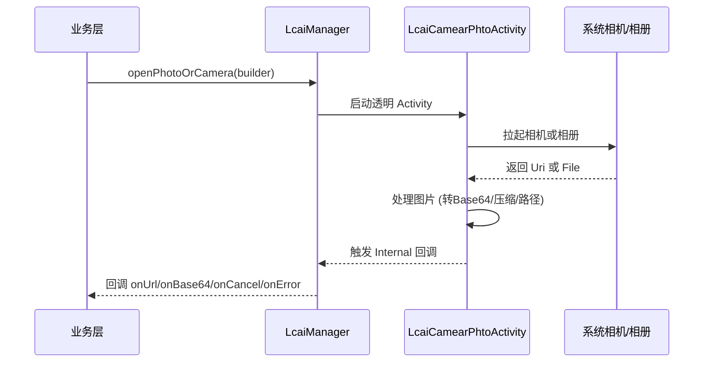

# Lcai 项目架构与开发指南

## 1. 项目整体架构与核心调度中心 (LcaiManager)

本项目采用组件化架构。为了保证模块解耦及复杂异步回调的精准分发，项目引入了 **`LcaiManager`** 作为单例门面（Facade）和调度中心。

> **⚠️ 核心开发规范**
> 涉及 `permission` (权限申请)、`camera_photo` (拍照/相册选取) 等存在生命周期和异步回调的模块，**业务层绝对不可直接 new 出对象调用，必须通过 `LcaiManager.getInstance()` 发起**。其内部会使用 `LcaiManager.Internal` 维护回调引用，保证跨模块调用时回调依然精准。

```mermaid
graph TD
    subgraph 业务层
        App[业务代码]
    end

    subgraph 统一调度门面
        Manager[LcaiManager]
    end

    subgraph 基础与功能模块
        Core[core (基础核心)]
        Perm[permission (动态权限)]
        Camera[camera_photo (相机相册)]
        Http[http (网络请求)]
        DB[lcaidb (数据库)]
        Image[image (图片处理)]
        Event[eventBus (事件总线)]
        Js[javascriptbridge (混合开发)]
        Comp[component (通用UI)]
        Dialog[tipsdialog (通用弹窗)]
    end

    App -->|权限申请| Manager
    App -->|拍照/选图| Manager
    Manager --> Perm
    Manager --> Camera

    App --> Comp
    App --> Dialog
    App --> Http
    App --> DB
    App --> Image
    App --> Event
    App --> Js
    App --> Core
```

## 2. core 模块 (核心基础库)
`core` 模块是整个项目的基石，提供全局上下文、Activity栈、日志、文件及核心职责调度。

### 2.1 职责调度器 `LcaiManager`
| 方法名 | 参数 | 返回值 | 功能说明 |
| :--- | :--- | :--- | :--- |
| `permissionReq` | `LcaiPermissionRequestBulider` | `void` | 发起权限申请。通过 `Internal.getPermissionResult()` 分发回调。 |
| `openPhotoOrCamera` | `LcaiCameraPhotoBuilder` | `void` | 发起拍照/选图。通过 `Internal.getPhotoCameraResult()` 分发回调。 |

### 2.2 全局工具 `GlobalAppUtil`
| 方法名 | 参数 | 返回值 | 功能说明 |
| :--- | :--- | :--- | :--- |
| `init` | `Application` | `void` | **必须调用**。初始化全局上下文、日志、Activity栈。 |
| `getActivity` | 无 | `Activity` | 获取当前栈顶（Resumed）Activity。 |
| `runOnUiThread` / `runOnUiThreadDelayed` | `Runnable`, `long` | `void` | 安全切换到主线程执行。 |
| `getStatusBarHeight` | `Activity`, `ComponentInterface` | `void` | 异步精确获取状态栏高度。 |
| `dp2px` / `px2dp` / `sp2px` | `float` | `int` | 尺寸换算。 |

### 2.3 Activity 栈管理 `LcaiActivityManager`
| 方法名 | 参数 | 返回值 | 功能说明 |
| :--- | :--- | :--- | :--- |
| `getResumedActivity` | 无 | `Activity` | 获取当前可见的 Activity。 |
| `isAppForeground` | 无 | `boolean` | 判断应用是否在前台。 |
| `finishAllActivities` | `Class<?>` | `void` | 结束所有 Activity，或指定结束某个类。 |
| `showLoading` / `dismissLoading` | `LoadingAction` | `void` | 无 Activity 时挂起任务，恢复时自动重放。 |

### 2.4 文件处理 `LcaiFileUtils`
| 方法名 | 参数 | 返回值 | 功能说明 |
| :--- | :--- | :--- | :--- |
| `getPath` | `Context`, `Uri` | `String` | **核心**。将 Uri 转真实路径。若受限，自动拷贝至应用沙盒缓存并返回。 |
| `saveImageToGallery` | `Context`, `File`, `LcaiFileInterface` | `void` | 保存到系统相册，兼容 Android Q 的 MediaStore。 |
| `convertImageToBase64` | `Context`, `Uri`, `boolean` | `JSONObject` | 转 Base64，超 1MB 自动压缩。 |

---

## 3. permission 模块 (高兼容性权限申请)
**⚠️ 必须通过 `LcaiManager.getInstance().permissionReq()` 调用。**

### 3.1 权限申请流程
```mermaid
flowchart TD
    A[发起申请] --> B{SDK < 23?}
    B -->|是| C[直接通过]
    B -->|否| D[解析存储抽象标识 & 过滤不支持权限]
    D --> E{检查是否已授予?}
    E -->|是| C
    E -->|否| F[进入 LcaiPermissionActivity]
    F --> G{包含特殊权限?}
    G -->|是 (所有文件)| H[跳转系统设置页] --> I[返回检查]
    G -->|否| J[拉起系统权限弹窗] --> I
    I --> K[记录状态 & 回调 LcaiReqPermissionResult]
```

### 3.2 核心 API
**`LcaiPermissionRequestBulider`**
| 方法名 | 参数 | 返回值 | 功能说明 |
| :--- | :--- | :--- | :--- |
| `with` | `Activity` | `Builder` | 设置上下文。 |
| `addPermission` | `String...` | `Builder` | 添加待申请权限（支持抽象标识）。 |
| `addNotification` | 无 | `Builder` | 适配 13+ 与低版本的通知权限申请。 |
| `showDialog` | 无 | `Builder` | 弹系统框前，先弹自定义说明窗。 |
| `check` | `boolean` | `Builder` | 仅检查不申请。 |
| `addResult` | `LcaiReqPermissionResult` | `Builder` | 设置回调。 |

**`LcaiPermissionString` (抽象标识)**
*   `STORAGE_READ_IMAGE`: API 33+ 自动映射为 `READ_MEDIA_IMAGES`。
*   `MANAGE_EXTERNAL_STORAGE`: 所有文件访问权限（特殊权限）。

**`PermissionsState` (状态枚举)**
包含 `ALL_GRANTED` (全过)、`PARTIALLY_REQUESTED` (部分过)、`ALL_DENIED_PERMANENT` (全永久拒绝) 等。

---

## 4. camera_photo 模块 (相机与相册)
**⚠️ 必须通过 `LcaiManager.getInstance().openPhotoOrCamera()` 调用。**

### 4.1 模块时序图


### 4.2 核心 API
**`LcaiCameraPhotoBuilder`**
| 方法名 | 参数 | 返回值 | 功能说明 |
| :--- | :--- | :--- | :--- |
| `addCheck` | `LcaiGalleryCheckType` | `Builder` | 设置类型：`CAMERA` (拍照) / `PHOTO` (相册)。 |
| `addResult` | `LcaiGalleryResultType` | `Builder` | 设置结果：`URL` (路径) / `BASE64` (编码)。 |
| `setAddHeader` | `boolean` | `Builder` | Base64 结果是否带 Header。 |
| `setSave` | `boolean` | `Builder` | 拍照后是否存入系统相册。 |

**`LcaiGalleryResult` (回调接口)**
包含：`onUrl(String)`、`onBase64(String)`、`onCancel()`、`onError(String)`。

---

## 5. http 模块 (原生网络请求库)
零第三方依赖，基于 `HttpURLConnection` 与全局线程池构建。

### 5.1 请求流程
```mermaid
flowchart TD
    A[LcaiHttpRequestBulider 构建] --> B[execute 发起请求]
    B --> C[提交至 GlobalThreadPool]
    C --> D[HttpURLConnection 建立连接]
    D --> E[写入 Header 和 Body]
    E --> F{获取 Response}
    F -->|失败| G[回调 onFailure]
    F -->|成功| H[根据 Call 类型解析]
    H -->|JSON/XML| I[回调 onSuccess(String)]
    H -->|RESPONSE| J[回调 onSuccess(InputStream)]
    H -->|DOWNLOAD| K[写入文件, 回调 onProgress]
```

### 5.2 核心 API
**`LcaiHttpRequestBulider`**
| 方法名 | 参数 | 返回值 | 功能说明 |
| :--- | :--- | :--- | :--- |
| `setUrl` / `setMethod` | `String` / `LcaiHttpMethod` | `Builder` | 设置地址和请求方法。 |
| `addMapParam` / `addJsonParams` | `Map` / `String` | `Builder` | 设置参数体。 |
| `addFileParam` | `String`, `File` | `Builder` | 添加文件上传。 |
| `setHttpSend` | `LcaiHttpSend` | `Builder` | 请求类型：`JSON` / `MAP` / `FORM_DATA`。 |
| `setHttpCall` | `LcaiHttpCall` | `Builder` | 响应类型：`JSON` / `RESPONSE` / `DOWNLOAD`。 |
| `execute` | 无 | `LcaiHttpRequest` | 发起异步请求。 |

**`LcaiBaseResponseResult` (回调)**
包含：`onFailure()`、`onSuccess(String)`、`onSuccess(InputStream)`、`onProgress()`、`isCancelled()`。